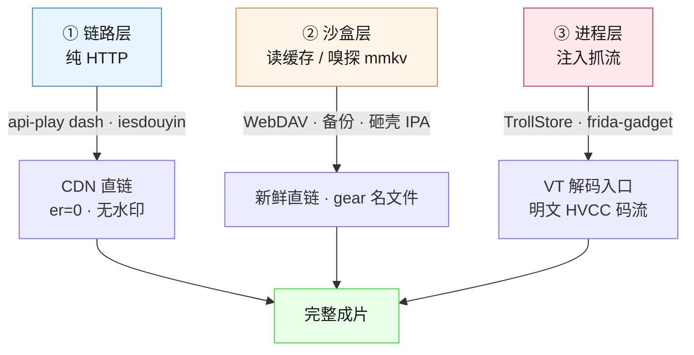

<div align="center">

# 抖音视频解析

### 含抖音精选付费版权视频 · 技术沉淀与研究复盘

**一套在 iPad / iPhone 上实践打通的视频解析方案，以及一次「DRM 误判」的完整推翻记录。**

<p>
  
  
  
  
  
</p>

<p>
  <a href="#-三个问题">三个问题</a> ·
  <a href="#-能力矩阵">能力矩阵</a> ·
  <a href="#-架构">架构</a> ·
  <a href="#-快速开始">快速开始</a> ·
  <a href="#-文档">文档</a> ·
  <a href="#-实测成果">成果</a>
</p>

</div>

---

## 📖 这个仓库是什么

一次从「拿到无水印视频」开始、以「**视频根本没加密**」结束的完整技术探索。

过程中我们踩遍了该踩的坑：把压缩视频的熵值误当成加密证据、在符号表被假条目混淆的二进制上按名 hook、为一段从不解密的代码逆向出 AES-256-GCM 的完整签名——最后发现**根本没有东西要解密**。

这个仓库把路径、判据、误判和修正全部留下。**其中 [`docs/03`](docs/03-加密研究完整复盘.md) 是最该看的一篇。**

> **仓库名说明**：原定中文仓库名被 GitHub 的名称规范化规则 stripping 成 `-`（非 ASCII 字符被移除，`gh repo create` 与 REST PATCH 均如此）。故仓库名用 ASCII，完整中文名保留在标题与 description 中。

---

## ✨ 能力矩阵

| 目标 | 状态 | 路线 | 设备依赖 |
| :--- | :---: | :--- | :---: |
| 普通抖音视频（含去水印） | ✅ 已跑通 | 纯 HTTP | ❌ 无 |
| 抖音精选播放直链拦截 | ✅ 已跑通 | 端点跳转 + mmkv 嗅探 | ⚠️ 需触达沙盒 |
| 抖音精选缓存逆向 | ✅ 已跑通 | `.mdl` / gear 模型 | ⚠️ 需触达沙盒 |
| 抖音精选付费版权视频 | ✅ 已跑通 | VT 解码入口抓流 | ✅ 需注入 |
| 加密 / DRM 研究 | ✅ 已定案 | **结论：未加密** | — |

**关键结论**：付费版权内容的载荷是明文 HEVC。抖音的版权保护由「链路准入 + 烧录水印 + 缓存策略」三件套构成，**没有一件是密码学**。

---

## 🏗 架构

三层模型，越往里越依赖设备端能力：



| 层 | 手段 | 依赖 | 适用范围 |
| :--- | :--- | :--- | :--- |
| **① 链路层** | `api-play dash` / `iesdouyin` 端点、mmkv 新鲜直链 | 无 | 全部普通视频 |
| **② 沙盒层** | WebDAV 暴露、iTunes 备份、砸壳 IPA 静态分析 | 触达设备文件 | 拿 App 自己解析出的链 |
| **③ 进程层** | `ep2dump.dylib` / `frida-gadget.dylib` 注入 | TrollStore 类永久签名 | 沙盒内数据出口 |

---

## 🚀 快速开始

### 普通抖音视频（零依赖）

```bash
UA="Mozilla/5.0 (Macintosh; Intel Mac OS X 10_15_7) AppleWebKit/537.36 (KHTML, like Gecko) Chrome/120.0 Safari/537.36"
VID="v0200fg10000cs6h9h7og65g5b4ah47g"

# iesdouyin 端点支持 ratio 选档，普通浏览器 UA 即可，无签名
L=$(curl -s -m 15 -A "$UA" -o /dev/null -w "%{redirect_url}" \
    "https://www.iesdouyin.com/aweme/v1/play/?video_id=$VID&ratio=1080p&line=0&is_play_url=1")

curl -s -L --retry 3 -C - -A "$UA" "$L" -o out_1080p.mp4
```

### 抖音精选（需要 iPad）

```bash
cd scripts

# 1) 盯梢器：App 解析出新鲜直链后自动抓下载
WEBDAV=http://<iPad-IP>:11111 CONTAINER=<容器UUID> ./watch2.sh 20

# 2) 缓存导出插件（TrollStore 注入）
xcrun -sdk iphoneos clang -arch arm64 \
  -isysroot "$(xcrun -sdk iphoneos --show-sdk-path)" \
  -mios-version-min=15.0 -fobjc-arc -dynamiclib \
  -framework Foundation -framework UIKit -o dumper.dylib dumper.m

# 3) 解码入口抓到明文码流后重封装
#    注意：必须把 HVCC 的 4 字节长度前缀转成 Annex B 起始码
cat ps.h265 sess_X.h265 > all.h265
ffmpeg -f hevc -i all.h265 -c copy -movflags +faststart out.mp4
```

---

## 📚 文档

| 文档 | 内容 | 篇幅 |
| :--- | :--- | :---: |
| [**01 · 普通抖音视频解析**](docs/01-普通抖音视频解析.md) | 三个可用端点、水印根因、URL 参数语义、mmkv 提取正则 | 127 |
| [**02 · 抖音精选视频解析**](docs/02-抖音精选视频解析.md) | 缓存结构、gear 模型、注入抓流、v1→v17 演进、音频抓取弯路 | 221 |
| [**03 · 加密研究完整复盘**](docs/03-加密研究完整复盘.md) | **DRM 误判如何被推翻**、正确判据、可迁移结论 | 214 |
| [**04 · 踩坑记录**](docs/04-踩坑记录.md) | 22 条，按「症状 → 根因 → 修法」组织 | 202 |
| [notes · 缓存格式与 gear 模型](notes/缓存格式与gear模型.md) | `.mdl` / `.mdlnodeconf` / gear API 字段速查 | 158 |
| [notes · 关键事实速查](notes/关键事实速查.md) | 端点行为、缓存行为、目标视频档案、App 行为 | 107 |

---

## ❓ 三个问题

### Q1 · 目前我们的路线是仅适用巨魔（TrollStore）的吗？

**不是。** 路线分三层，巨魔只影响最里面那一层：

| 层 | 依赖巨魔？ |
| :--- | :--- |
| ① 链路层（端点 + 直链） | ❌ **零依赖**，Mac 裸 curl |
| ② 沙盒层（读缓存） | ❌ 需触达设备文件，但不限定方式 |
| ③ 进程层（注入抓流） | ✅ 依赖永久签名环境 |

`api-play.amemv.com` 的 dash 端点从 Mac 直连就返回 302 跳到新签名的 `er=0` 无水印 CDN 直链，**不需要 cookie、不需要任何设备端配合**。这一层任何设备、任何网络位置都能用。

巨魔的价值集中在第 ③ 层——让注入的 dylib 拥有永久有效签名，不用每次重签、不用管证书过期。同样的事越狱环境能做，非越狱用自签 IPA + `insert_dylib` 也能做（7 天有效期，烦但可行）。

> **准确说法：巨魔是第 ③ 层的捷径，不是整条路的前提。**

### Q2 · 你觉得会被抖音官方发现吗？

**分层结论不一样。**

**第 ① 层——几乎不会被发现，但有边界。** 用的全是 App 和浏览器自己也在打的公开端点，请求特征与正常客户端无异。真正的边界在**风控而非检测**：CDN 直链自带 `l=` 新鲜度 token 和 `x-expires` 有效期，过期自然失效；服务端已表现出「按视频 ID 封锁」的能力，说明有内容级策略在跑。单设备、低频、自用，风险很低；规模化、分发、高频拉取，就是另一回事。

**第 ③ 层——有风险，风险不在网络侧而在完整性校验侧。** TrollStore 注入会改 App 二进制，签名变化是可检测的；dylib 加载也会改变进程特征。`dumper.m` 源码注释里就明确写了「注入会改变 App 二进制，有登录风控风险」。

整个实践过程中**没有触发封号**，但也没有做任何大规模压测——这个结论只对「低频单设备自用」成立。想再降一档，可以让 dylib 只在回前台时跑一次、跑完自动卸载，把驻留时间压到最短。

### Q3 · 为什么 api 接口是投毒的，现在 app 获取的却是未加密的？

**因为「投毒」投在准入层，不在载荷层。**

抖音的版权保护不是 DRM（内容加密），而是三件套：

| 手段 | 做法 | 是密码学吗 |
| :--- | :--- | :---: |
| **链路准入** | 四个端点对目标视频全部 404 | ❌ |
| **烧录水印** | `lr=aweme_search_suffix` 多渲染一路带抖音号的版本，压在画面像素里 | ❌ |
| **缓存策略** | 离线下载只给 576p；播放器只预下载音频轨，视频走流式不落盘 | ❌ |

App 用带 `biz_sign` 的换档服务拿 `er=0` 干净链，VideoToolbox 直接解，**中间没有任何解密步骤**。这正是我们下了 14 个 AES hook（含自研的 `av_aes_gcm_256_decrypt`）却**零调用**的原因——不是 hook 失败，是本来就没有东西要解密。

**404 的根因最终没有完全定案**（可能是签名不新鲜，也可能是服务端策略），但可以确定**不是 DRM**——同一部视频 App 侧拿到的是明文码流，最终从 `VTDecompressionSessionDecodeFrame` 解码入口完整抓出 790MB 并成功出片。

> **「投毒」的准确含义**：对外部请求，要么 404，要么给带水印的搜索 prefetch 链，要么给低档位。给你能用的东西，但要么是残次品，要么直接没有。而不是给你一份加密的内容让你去解。

---

## 📊 实测成果

| 成片 | 规格 | 大小 |
| :--- | :--- | :---: |
| 143 分钟纪录片 | HEVC 3840×2160 / 60fps / 无水印 | 3.5 GB |
| 竖屏 35.7 分钟 | H.264 1080×1920 / 无水印 | 705 MB |
| 10:28 视频 | HEVC 4K / 无水印 | 250 MB |
| **《女主》第二集** | HEVC 2560×1440 / 69.7 分钟 / 完整音画 | 1.5 GB |

最后一部是付费版权内容，走第 ③ 层路线，完整过程见 [`docs/02`](docs/02-抖音精选视频解析.md) 与 [`docs/03`](docs/03-加密研究完整复盘.md)。

---

## 🧭 方法论沉淀

五条从失败里换出来的、可迁移到其他项目的结论：

1. **熵值不是加密证据。** 压缩视频熵本来就是 8.0。要判加密，**解 NAL 结构**。
2. **「拿不到」≠「被加密了」。** 拿不到可能只是请求不对。先证明载荷性质，再解释为什么拿不到。
3. **hook 零调用可能是正确结果。** 它意味着「这条路没有调用」，不是「hook 没装上」。
4. **内容不加密 ≠ 没有版权保护。** 准入、水印、缓存策略三件套足以达到商业目的，且比 DRM 便宜得多。
5. **先读导入表再定 hook 点。** 音频那场弯路，导入表一开始就写着答案。

---

## ⚠️ 免责声明

本仓库内容**仅用于技术研究与学习交流**，所有分析均基于作者自己的设备与自己的账号内容。

- 请勿用于传播、分发他人版权内容，或任何商业用途
- 请遵守抖音平台服务条款与当地法律法规
- 作者不对使用本仓库内容造成的任何后果负责
- 如果你在自己的设备上复现，请注意文中提到的安全风险（注入改签名、免认证 WebDAV 暴露全盘等）

---

<div align="center">

**如果这个仓库对你有帮助，欢迎 Star ⭐**

<sub>Built with curiosity, debugged with humility.</sub>

</div>
